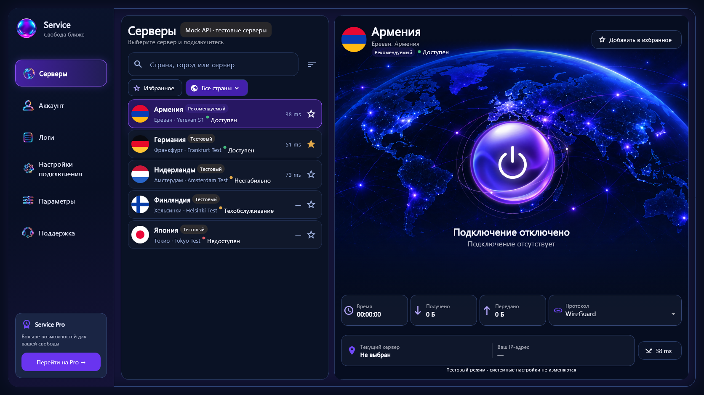
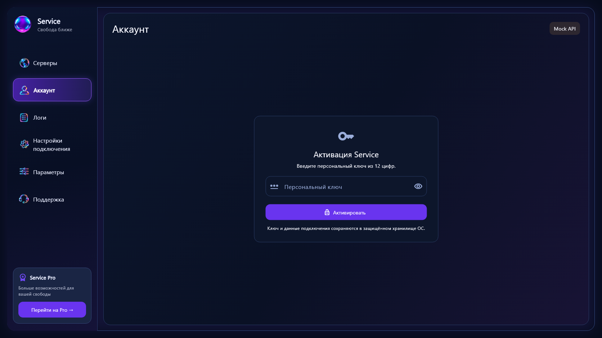
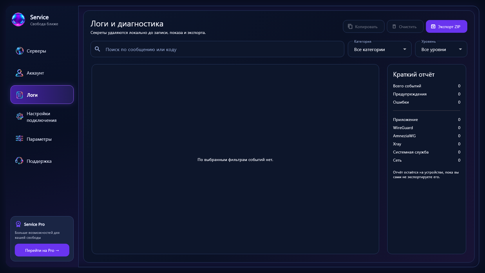
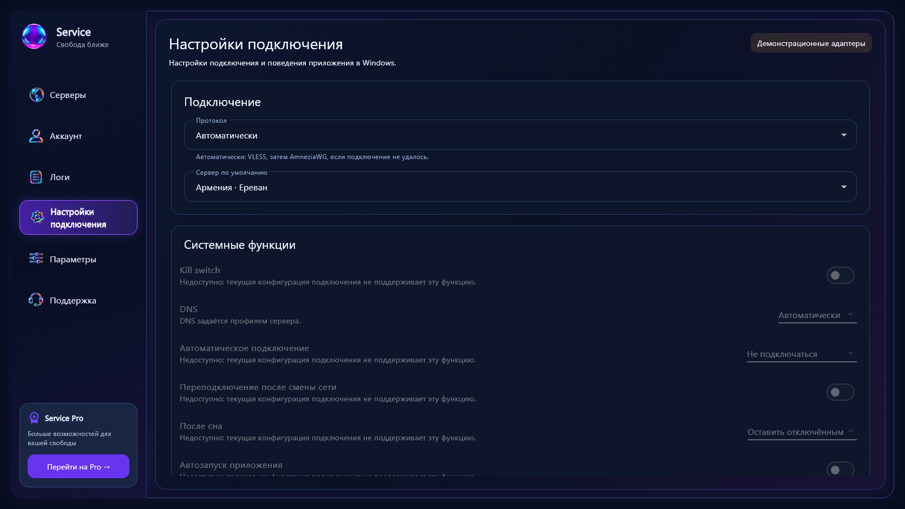
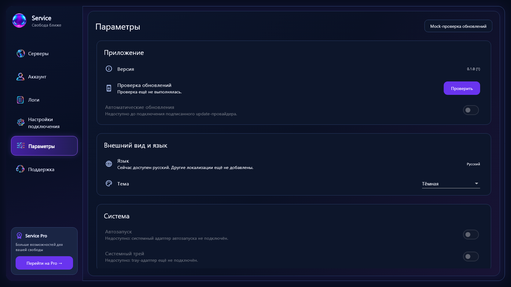
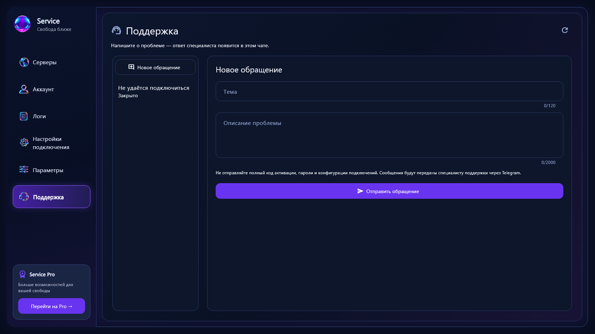

# Service — приложение для Windows

Service помогает подключить компьютер с Windows 10 или 11 к выбранному серверу. Пользователь активирует подписку по ключу, управляет подключением и видит задержку, время сеанса и трафик.



## Разделы приложения

<details>
<summary>Серверы</summary>

Выберите локацию, посмотрите задержку, добавьте узел в избранное и начните или завершите подключение.


</details>

<details>
<summary>Аккаунт</summary>

Активируйте доступ по ключу, проверьте срок подписки и лимит устройств.



</details>

<details>
<summary>Логи</summary>

Посмотрите события подключения. При необходимости подготовьте диагностический отчёт с маскировкой секретов.



</details>

<details>
<summary>Настройки подключения</summary>

Выберите протокол, настройте DNS и параметры переподключения.



</details>

<details>
<summary>Параметры</summary>

Выберите тему и настройте автозапуск, сворачивание и значок в трее.



</details>

<details>
<summary>Поддержка</summary>

Создайте обращение и прочитайте ответ внутри приложения, если поддержка настроена на сервере.



</details>

Скриншоты сняты в локальном режиме на демонстрационных данных.

## Как устроен проект

- **Flutter и Dart** — интерфейс Windows. `flutter_secure_storage` хранит данные доступа, `win32` и `ffi` связывают приложение с Windows, `pdfrx` открывает встроенные PDF.
- **Rust** — системная служба управляет подключением. Интерфейс общается с ней по типизированному IPC. Профили защищены средствами Windows DPAPI.
- **AmneziaWG и Xray** — обработка соединения по протоколам AmneziaWG и VLESS + REALITY.
- **HTTPS API [Панели-Service](https://github.com/pasha-tsaran/Panel-Service)** — `POST /api/v1/activate` активирует доступ и получает параметры подключения, `/api/v1/support/` обслуживает обращения при включённой поддержке.

Экраны находятся в `apps/desktop/`, общие модели и компоненты — в `packages/`, контракты и системный код — в `crates/` и `services/`.

## Запуск и проверка

Для сборки нужны Flutter с поддержкой Windows, Rust и Visual Studio с инструментами C++. На чистой установке сразу включается тёмная тема.

```powershell
flutter pub get
cd apps/desktop
flutter run -d windows
```

Режим разработки открывает интерфейс с демонстрационными адаптерами. Для подключения нужны [сборка установщика](DEVELOPMENT.md) с адресом HTTPS API и действующий ключ доступа.

```powershell
flutter test
cd ../..
cargo test --workspace --locked
```
