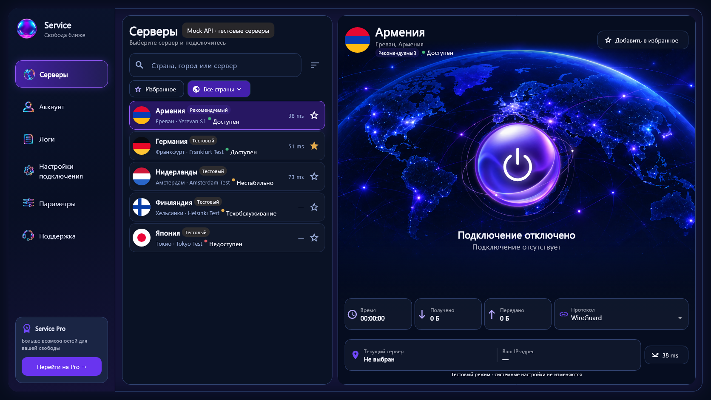
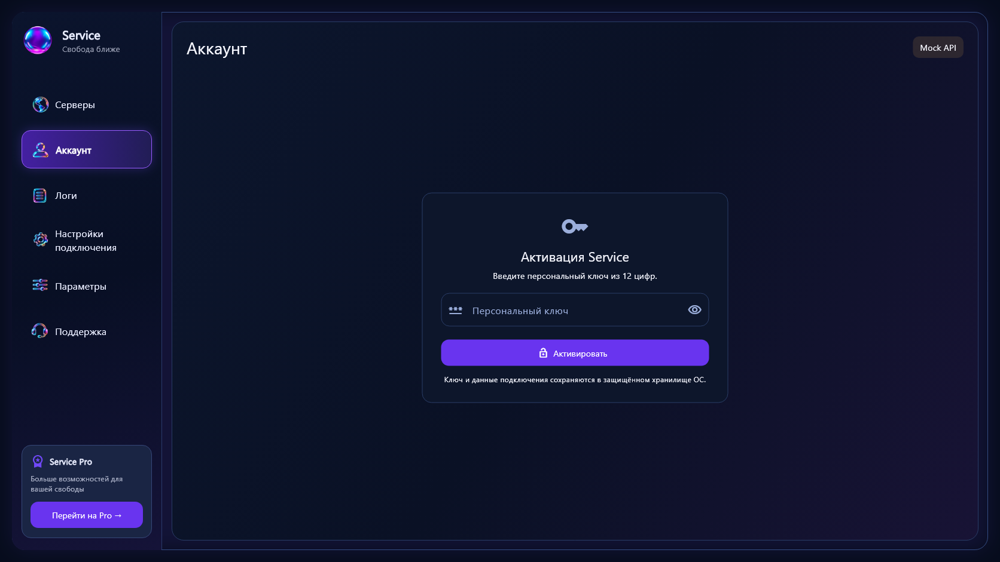
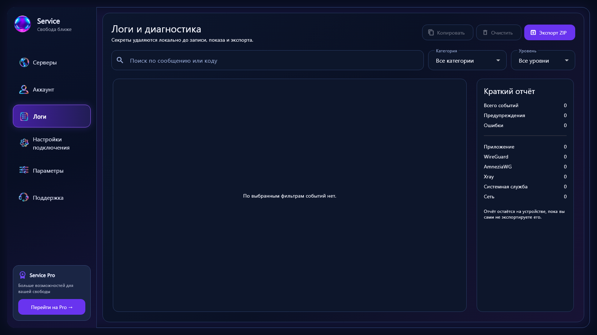
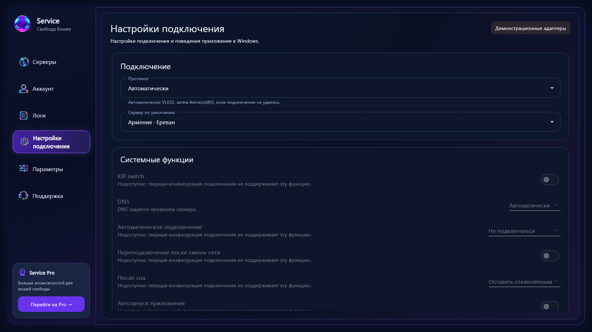
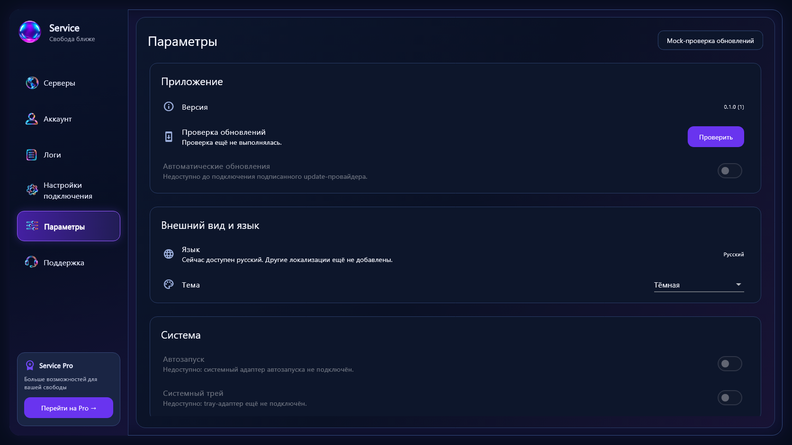
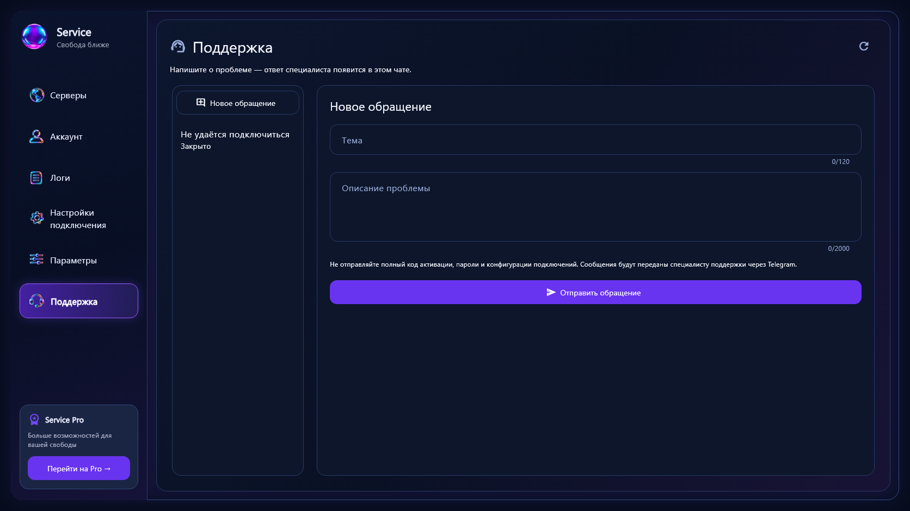

# Разделы приложения Service

[Вернуться в README](../README.md)

## Серверы

Выбор узла и управление соединением.

## Аккаунт

Ввод ключа активации и сведения о подписке.

## Логи

Журнал и диагностика.

## Настройки подключения

Выбор протокола и параметры запуска соединения.

## Параметры

Оформление, автозапуск и значок в трее.

## Поддержка

Список обращений и ответы.

